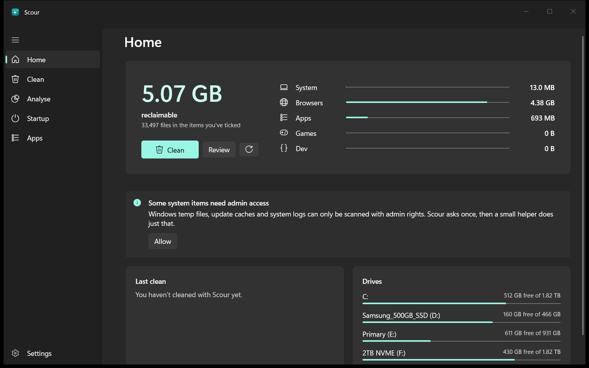
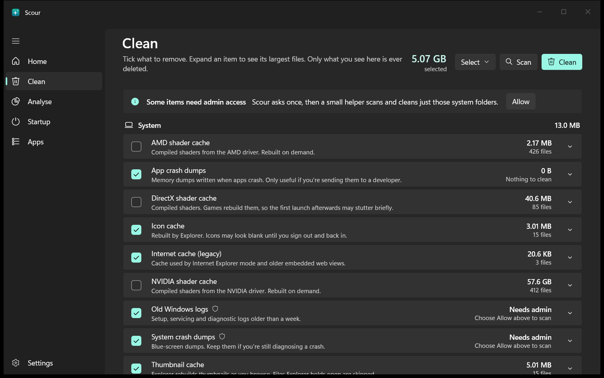
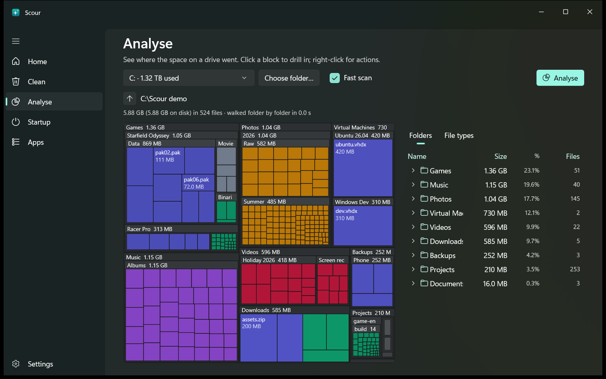
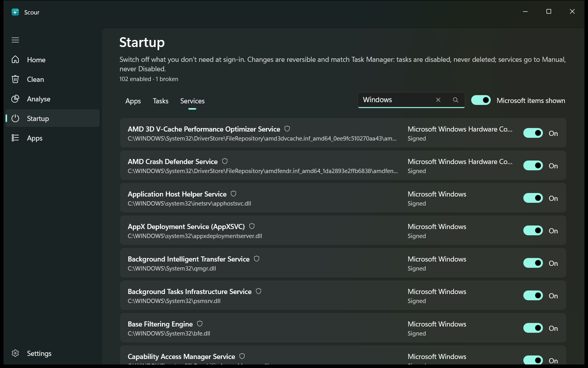
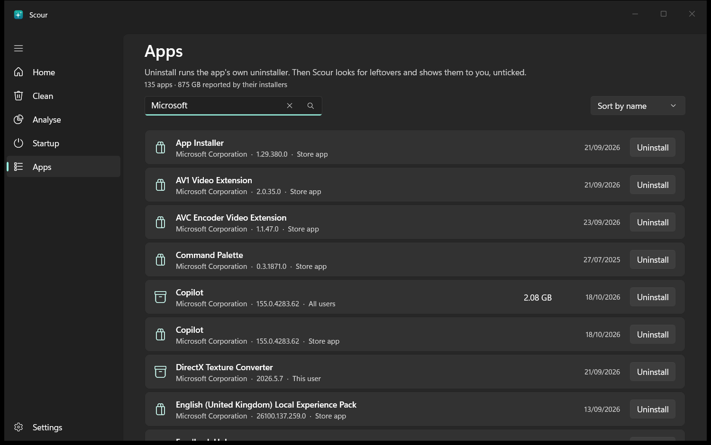
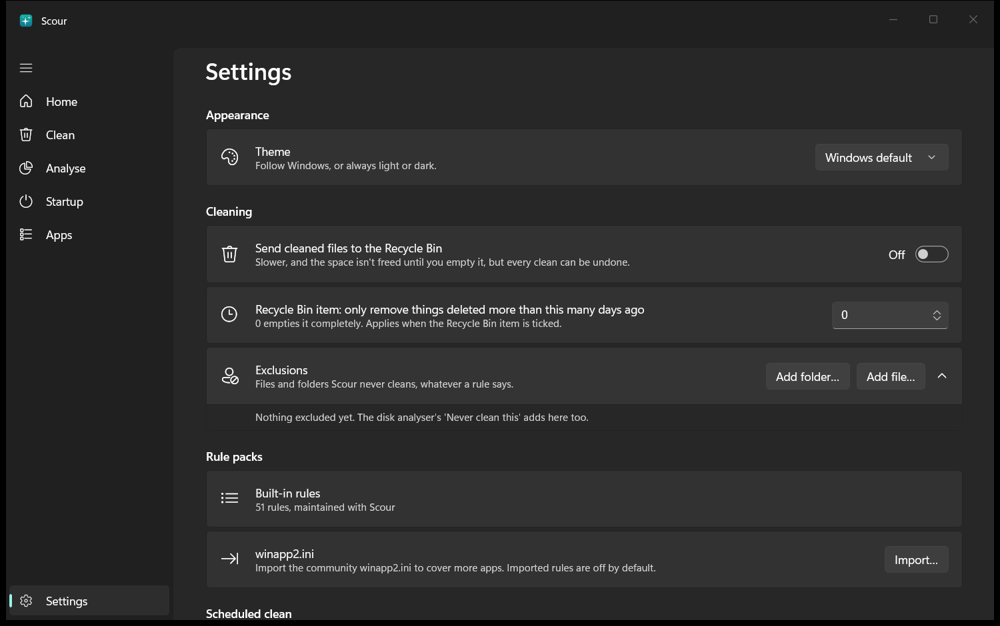

<p align="center"></p>

<h1 align="center">Scour</h1>

<p align="center"><b>A free, open-source Windows cleaner: the tool CCleaner used to be, minus the bloat.</b><br>
It frees disk space, shows where the space went and tidies what starts with Windows,<br>and it never deletes anything you haven't seen first.</p>

<p align="center">
  <a href="https://github.com/STR0UDY/scour/releases/latest"><b>Download for Windows</b></a> ·
  <a href="#install">Install</a> ·
  <a href="#how-a-clean-stays-safe">Is it safe?</a> ·
  <a href="CONTRIBUTING.md">Add an app</a>
</p>

<p align="center"></p>

---

## What is it?

Scour is a small Windows 10/11 app that finds the junk your PC piles up (temp files, caches, crash dumps, old logs), shows you exactly what it found and removes only what you tick. There are no ads, upsells, accounts, telemetry or background services, and no registry "cleaning" that breaks things.

It does four things:

### 1. Clean

Scan, review, clean. Every item says what it is and how much it frees, and you can expand it to see the files. Risky items such as cookies, history and the Recycle Bin are off until you turn them on. Anything that needs admin waits behind a single **Allow** button.

<p align="center"></p>

Covers Windows temp files, Windows Update and Delivery Optimisation caches, crash dumps, error reports, old logs, thumbnail and icon caches, and GPU shader caches. It also covers browsers (Chrome, Edge, Brave, Opera, Firefox), apps (Discord, Spotify, Teams, Slack, VS Code), game launchers (Steam, Epic, Battle.net, FiveM), developer caches (npm, Yarn, NuGet, pip, Gradle, Cargo) and the Recycle Bin.

### 2. Analyse

See where the space went. Scour draws any drive or folder as a treemap, where the bigger the block, the bigger the folder. Click to drill in, and right-click to open in Explorer or move something to the Recycle Bin. With fast scan it reads the drive's file table directly, so a whole drive takes seconds.

<p align="center"></p>

### 3. Startup

Everything that starts with Windows, with a verified publisher for each: apps, scheduled tasks and services. Entries that point at a program that no longer exists are flagged. Switching things off is reversible, just like Task Manager, and Microsoft items are hidden by default so you can't break Windows by accident.

<p align="center"></p>

### 4. Apps

Every installed app, desktop and Store. **Uninstall** runs the app's own uninstaller, then Scour looks for leftover folders and shortcuts and shows them to you, all unticked.

<p align="center"></p>

And it's all scriptable: `scour scan`, `scour clean --dry-run`, `scour analyse C:` and more, from any terminal.

<details>
<summary>Settings</summary>
<p align="center"></p>
</details>

## Principles

- **Preview before delete.** Every clean is a scan first, with paths and sizes. There is no blind one-click wipe.
- **Nothing hidden.** No telemetry, no ads, no account, no tray icon, no background service. Update checks are opt-in.
- **Rules are data.** Every cleanable location is a JSON rule in [`rules/`](rules) that anyone can read and audit.
- **Safe by default.** Cookies, history, saved sessions and the Recycle Bin are off until you tick them.
- **Least privilege.** The app runs as you. A tiny helper is elevated only when you tick something that needs it.

Not included, on purpose: a registry cleaner, RAM "optimisers", driver updaters, "PC health" scores, Prefetch cleaning and secure wipe. None of them make Windows measurably better.

## Install

1. Go to [Releases](https://github.com/STR0UDY/scour/releases) and download the MSI for your PC: `win-x64` for most PCs, `win-arm64` for Snapdragon/ARM laptops.
2. Run it. Scour appears in the Start menu, and `scour` works in any terminal.
3. Open Scour and press **Scan**. Nothing is deleted until you press **Clean** and confirm.

Prefer not to install? Each release also has a portable `.zip`: unzip it anywhere and run `ScourApp.exe`.

Requires Windows 10 22H2 or Windows 11. Everything Scour needs is bundled, so there's nothing else to install.

> Early releases aren't code-signed yet, so Windows SmartScreen may say it "protected your PC". Choose **More info → Run anyway**, or build it yourself from source (below).

## Using the CLI

| Command | What it does |
| --- | --- |
| `scour scan [--profile quick\|deep\|dev] [--all] [--json]` | What would be removed. Changes nothing. |
| `scour clean --dry-run` | Re-verifies every file as if deleting, deletes nothing. |
| `scour clean [--recycle] [--yes] [--elevate]` | Shows the preview, asks `[y/N]`, then cleans. `--elevate` runs admin rules via the helper. |
| `scour analyse C: [--types]` | Largest folders and files, and space by file type. |
| `scour startup list` / `enable` / `disable <id>` | Startup items. |
| `scour apps list` / `uninstall <name> [--remove-leftovers]` | Installed apps. |
| `scour rules list` / `lint` / `import-winapp2 <file>` | Rules and rule packs. |

Rules can be picked by id (`-r browser.chrome.*`), category (`-c Browsers`) or profile (`--profile quick`).

## How a clean stays safe

1. Rule targets are expanded (env vars, browser profiles, wildcard folders).
2. Files are listed, never following links or junctions, skipping excludes and anything newer than the rule's age limit.
3. Every target folder and file is checked against a hard deny-list rules can't override: drive roots, `C:\Windows` itself, `System32`, `WinSxS`, the `Program Files` and profile roots, and the whole of Documents, Desktop, Pictures, Music, Videos, Downloads and OneDrive.
4. You see the results.
5. On Clean, each file is reopened without following links, and its size, timestamp and *real* path must still match what you saw and still pass the deny-list.
6. It's deleted through that same handle (or sent to the Recycle Bin). Locked files are skipped and counted, never forced.
7. Every outcome is logged to `%LOCALAPPDATA%\Scour\logs`.

Admin rules go through `Scour.Elevator`. It's reachable only by the Scour process that started it, accepts rule ids rather than paths, rescans those rules itself and deletes only files that both its scan and yours found. See [SECURITY.md](SECURITY.md).

## Building

Requires Windows 10 22H2+ and the .NET 10 SDK.

```bash
dotnet build
```

```bash
dotnet test
```

```bash
./build/publish.ps1
```

`publish.ps1` produces self-contained x64 and ARM64 folders, zips and MSIs in `artifacts/`. Set the signing variables described at the top of the script to sign them.

```
src/Scour.Core/      engine: rules, scanner, cleaner, deny-list, analyser, startup, apps (no UI)
src/Scour.App/       WinUI 3 app (unpackaged)
src/Scour.Cli/       System.CommandLine front end
src/Scour.Elevator/  admin helper, named-pipe server
src/Scour.Ipc/       message contracts shared by Core and the helper
rules/               built-in JSON rules
installer/           WiX MSI
packaging/winget/    winget manifest templates
tests/               engine sandbox tests, deny-list tests, rule lint
```

## Contributing

Adding support for an app is usually one JSON file. See [CONTRIBUTING.md](CONTRIBUTING.md).

## Licence

[GPL-3.0](LICENSE). GPL makes sure nobody can repackage Scour with adware and keep the changes closed.
